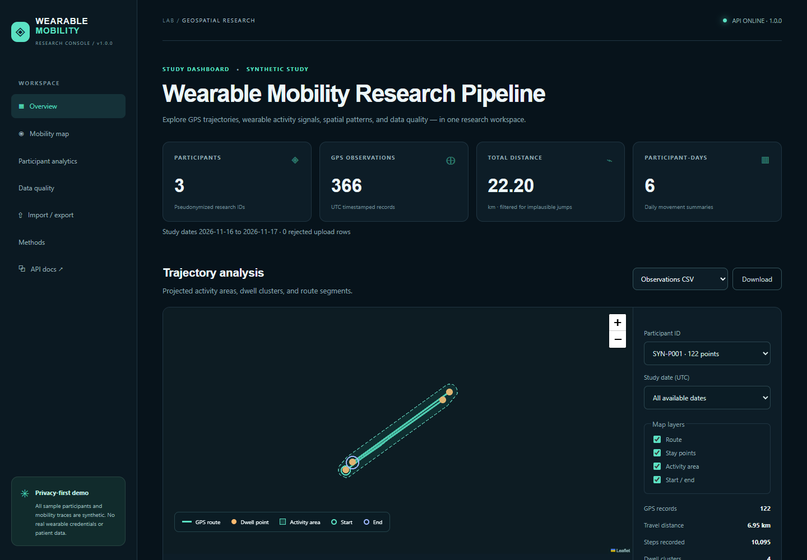
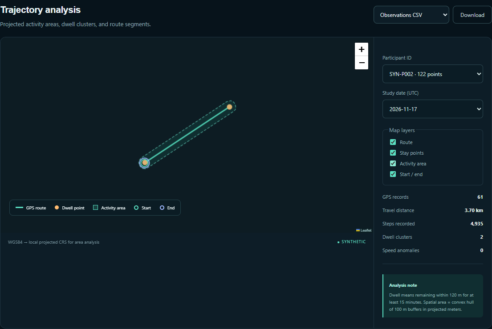
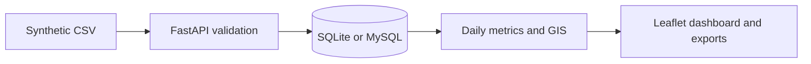

# Wearable Mobility Research Pipeline v1.0.0

An independent geospatial research software portfolio project. All participants, wearable records and trajectories are synthetic. The Fitbit-shaped fixture runs locally and uses no Fitbit API, OAuth, or research subjects. It shows how a research team could validate wearable-shaped CSV, audit ingestion, inspect GPS movement, and reproduce exports using deterministic synthetic data.





**Stack** · Python 3.12 · FastAPI · SQLAlchemy · Alembic · SQLite / MySQL · GeoPandas · Leaflet · pytest · Playwright



**Release verification** · See [v1.0.0 release report](docs/RELEASE_REPORT.md) for SQLite, MySQL, Edge and Docker results.

## Live Demo

The public Render URL is pending publication approval. See [Render deployment and acceptance](docs/DEPLOYMENT.md#render-free-blueprint).

## Start on Windows

Install Python 3.11+ and open the project folder in VS Code. In PowerShell:

```powershell
.\scripts\start_windows.bat
```

The dashboard is at **http://127.0.0.1:8000/** and Swagger is at **http://127.0.0.1:8000/docs**. Press Ctrl+C to stop. Set `MOBILITY_PYTHON` to the full interpreter path if your Windows Python launcher cannot find it.

```powershell
$env:MOBILITY_PYTHON = "$env:LOCALAPPDATA\Programs\Python\Python312\python.exe"
.\scripts\start_windows.bat
```

The starter creates a local virtual environment, installs dependencies, applies Alembic migrations, and seeds 366 observations for three synthetic participants over two UTC days when the canonical demo is absent. It preserves existing demo rows.

## Explore the demo

- Select a participant and study date. Toggle route, stay points, the projected area, or start/end markers. Daily analytics follow the map selection.
- Upload `data/synthetic_wearable.csv` to see a replay report with zero additional observations. Use `static/sample_schema.csv` as a header and row example.
- Compare Observed Validity Rate and Expected Sampling Coverage in Participant Analytics. Coverage shows **N/A** until a study observation window and cadence are configured.
- Review rejected row numbers and reasons by import batch. Import history and all diagnostics are stored in the database.
- Download observations or daily metrics as CSV, each map layer as GeoJSON, and analysis metadata as JSON. CSV responses carry metadata in `X-Research-Metadata`; save the JSON metadata alongside a downloaded CSV.
- Open `http://127.0.0.1:8000/?basemap=none` for local vector rendering without remote map tiles. The standard basemap needs internet access.

[GIS map](docs/screenshots/gis-map.png) · [Data quality](docs/screenshots/data-quality.png) · [Participant analytics](docs/screenshots/analytics.png)

## Architecture and methods

FastAPI serves the Leaflet dashboard and SQLAlchemy queries. SQLite is the default database; Alembic upgrades new and legacy installations. A separate MySQL 9.0 instance was exercised with the same migrations and APIs. Imports hash the spooled file, stream CSV records in bounded chunks, validate and normalize offset-aware timestamps to UTC, deduplicate against a database unique key, and commit accepted records and diagnostics within one transaction.

The GIS methods use screened Haversine segments for route distance, anchor-radius stays for contiguous dwell, and a projected buffer hull for activity area. `STUDY_TIMEZONE` selects the IANA zone used for grouping and filtering study days. It defaults to UTC. See [Architecture](docs/ARCHITECTURE.md) and [Research methods](docs/RESEARCH_METHODS.md).

## Test

```powershell
.\.venv\Scripts\python.exe -m pip install -r requirements-dev.txt
.\.venv\Scripts\python.exe -m pytest -q
$env:RUN_BROWSER = "1"
$env:BROWSER_CHANNEL = "msedge"
.\.venv\Scripts\python.exe -m pytest -q
```

With Playwright Chromium, run `python -m playwright install chromium` and omit `BROWSER_CHANNEL`. Tests use isolated databases. See the [test report](docs/TEST_REPORT.md).

## Scope

- Implemented: migration-backed import auditing, streaming validation, UTC and DST-aware study dates, map and daily analytics, rejection review, export metadata, and opt-in restore for marked SQLite demo databases.
- Implemented: a synthetic study, participant-to-source associations, accepted raw field snapshots and batch-level provenance, a local mock wearable adapter, and a CLI for repeatable daily analysis runs.
- Planned: study/cohort administration, observation-level history for derived spatial flags, full-study query scaling, and Docker runtime verification.

Upload only explicitly fabricated synthetic data. A declared source label is a policy check and cannot establish provenance. This project has no institutional affiliation and no clinical validation or real device integration. See [Privacy](docs/PRIVACY.md), [API](docs/API.md), [Data dictionary](docs/DATA_DICTIONARY.md), and [Deployment](docs/DEPLOYMENT.md). Original project code uses the [MIT License](LICENSE); vendored Leaflet retains its [license](static/vendor/leaflet/LICENSE).
